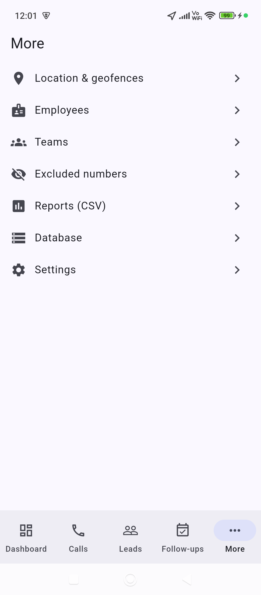
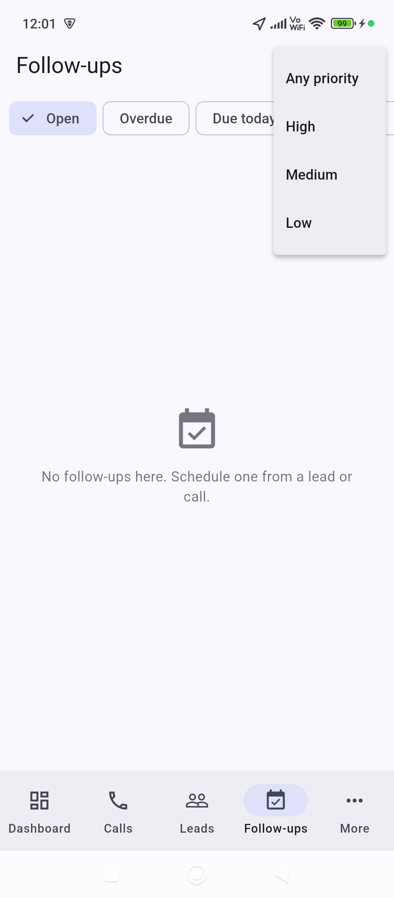
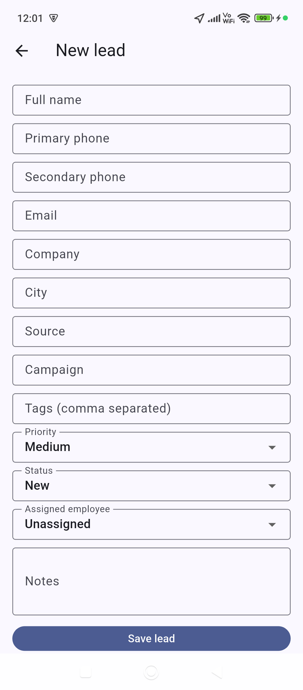
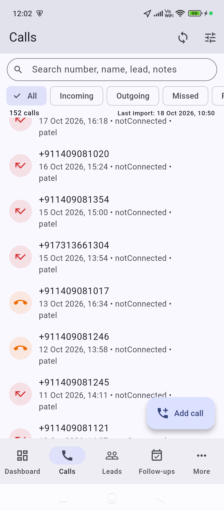
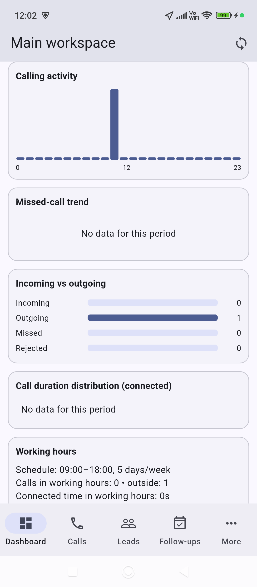
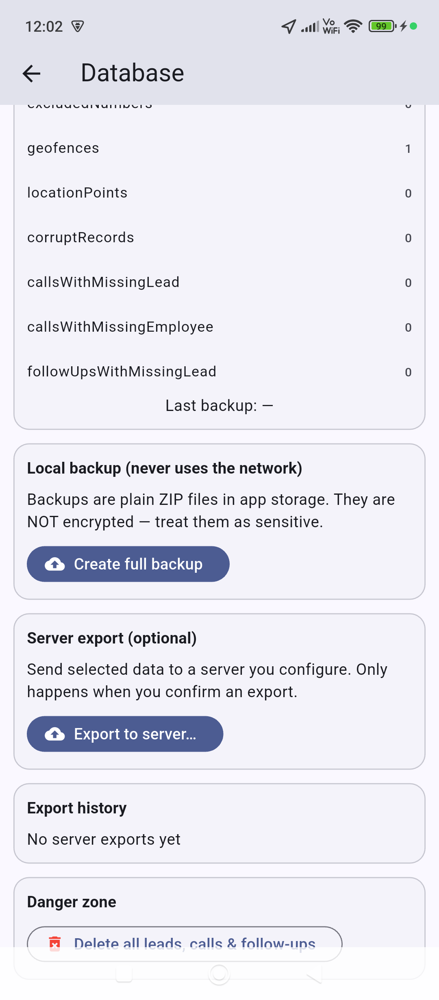
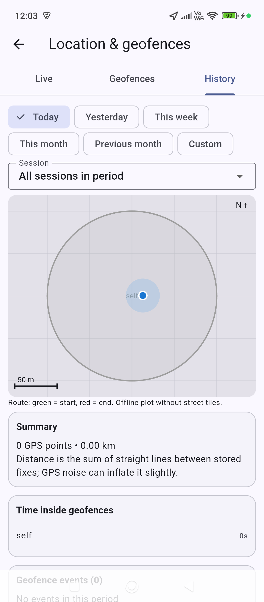
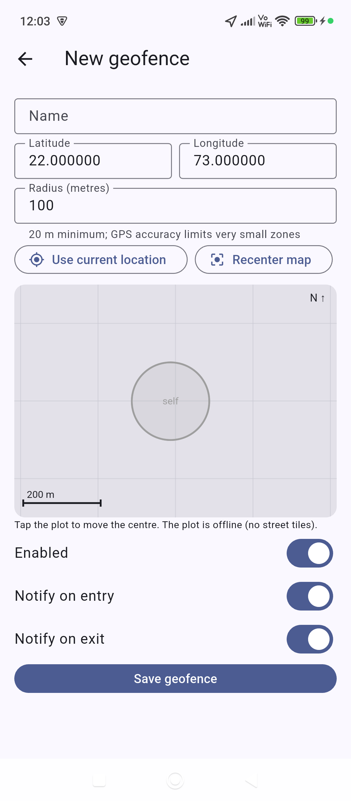
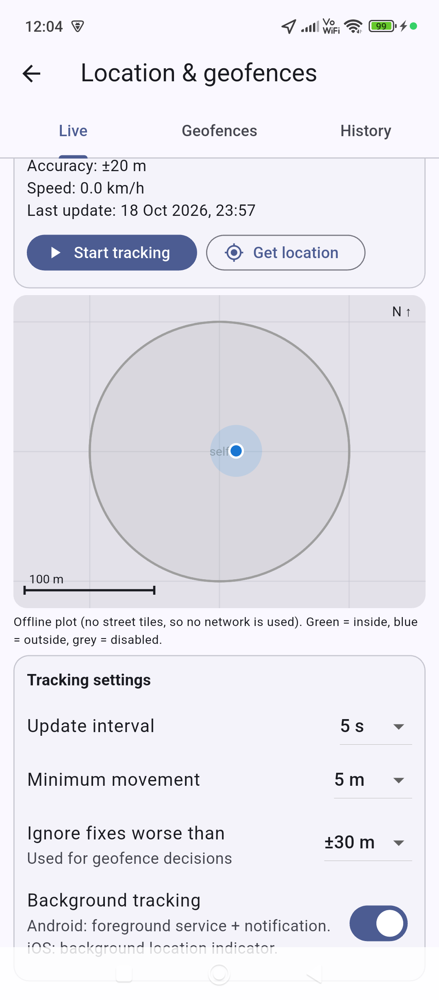

GalleonTrack
<p align="center">

</p>

<h3 align="center">Navigate Your Tracking Journey</h3>

<p align="center">
A smarter way to track, manage, and stay connected with what matters.
</p>

<p align="center">
<a href="https://github.com/galleonsoft/galleontrack">

</a>


</p>

🌟 About GalleonTrack
GalleonTrack is a tracking application developed by GalleonSoft. This repository contains the project source code and application assets.

Explore the screenshots below to get a visual overview of the application.

✨ Highlights
📱 Application Interface — Explore the app's screens and user experience.
🧭 Tracking Experience — A dedicated application for tracking-related workflows.
🎨 Modern Presentation — An interface designed to make app interactions easy to follow.
💻 Open Repository — Explore the source code and follow the project's development on GitHub.
📸 Application Screenshots
Take a look at GalleonTrack in action.

🖼️ Screen 01
<p align="center">

</p>

🖼️ Screen 02
<p align="center">

</p>

🖼️ Screen 03
<p align="center">

</p>

🖼️ Screen 04
<p align="center">

</p>

🖼️ Screen 05
<p align="center">

</p>

🖼️ Screen 06
<p align="center">

</p>

🖼️ Screen 07
<p align="center">

</p>

🖼️ Screen 08
<p align="center">

</p>

🖼️ Screen 09
<p align="center">

</p>

🖼️ Screen 10
<p align="center">

</p>


# GalleonTrack

Offline-first call tracking, lead management, analytics and location tracking / geofencing (Flutter + Hive CE). Android is primary; the location module also targets iOS.
No account, no cloud, no background sync. The **only** network feature is the optional,
user-confirmed `POST /api/v1/database-export`.

> **Build status — read this first.** The source was written without access to a Flutter SDK or
> package registry, so it has **not been compiled or run**. Expect to fix a few compile errors
> on the first `flutter analyze`. The tests were written but not executed.

## Dependencies (kept minimal)
`flutter_riverpod`, `hive_ce`, `path_provider`, `intl`, `archive`, `geolocator`, `flutter_local_notifications`. Everything else (call log,
dialer, file sharing, runtime permission) is a small Kotlin MethodChannel in `MainActivity.kt`.
Navigation uses the built-in Navigator (no go_router); records are stored as JSON strings in
Hive CE boxes, so no code generation / adapters / build_runner is needed.

## Setup
```bash
./setup.sh                # flutter create (android only) + re-applies native files
# then: set applicationId/namespace to com.galleontrack.app in android/app/build.gradle(.kts)
# merge android/AndroidManifest.snippet.xml into android/app/src/main/AndroidManifest.xml
flutter pub get
flutter analyze
flutter test
flutter run
flutter build apk --release
```
Requires Flutter ≥ 3.27 (uses `Color.withValues`), Dart ≥ 3.3.

## Location & geofencing (More -> Location & geofences)
- **Live:** current lat/lng, accuracy, speed, last-update time; start/stop sessions; configurable interval, minimum movement and accuracy threshold; background mode (Android foreground service + notification, iOS background-location indicator).
- **Geofences:** circular zones (name, lat, lng, radius >= 20 m); create, edit, delete, enable/disable; per-fence entry/exit notification toggles; "use current location"; tap-to-place on the plot; local notifications on entry/exit.
- **History:** GPS points (UTC), sessions, geofence events, route plot, distance, time inside each fence (today/week/month/custom), CSV export of points / events / time-inside, delete by age or everything. Geofences, events, sessions and points are included in local backups, and in the server export only if you select them.
- **Detection rules:** fixes worse than the accuracy threshold (default 100 m) are ignored; a transition needs 2 consecutive agreeing fixes; exit needs distance > radius + 10 m. Event types: `enter`, `exit`, `suspend` (tracking stopped, or fence disabled/deleted while inside; closes the interval without claiming the user left).
- **Time inside** = enter -> exit/suspend intervals clipped to the period; an interval still open is capped at "now" while tracking, otherwise at the last recorded fix.
- **The "map" is an offline plot** (metric grid, scale bar, fences, route, position), not street tiles. Tile maps need network requests, which this app's no-network rule forbids.
- **Limits:** tracking never auto-starts and is not resumed after the process is killed or the device reboots. Geofences are evaluated in-app from GPS fixes (not OS region monitoring), so detection only works while a session runs. Short intervals drain battery; indoor accuracy can be poor; OEM battery savers may stop background services.
- **Extra setup:** merge `android/AndroidManifest.snippet.xml` (permissions + desugaring note) and `ios/Info.plist.snippet.xml`; add `ios/NativeBridge.swift.txt` to AppDelegate (iOS share sheet). iOS has no call-log API, so call import is Android-only.
- Tests: `test/geo_test.dart`. Schema is now v2 (new boxes `geofences`, `location_points`, `geo_events`, `tracking_sessions`).

## Implemented
- Onboarding/workspace (offline), admin profile, theme, optional call-log permission, labelled demo data (removable)
- Hive CE database: 9 boxes, schema version + migration hook, startup error screen, health check, audit events
- Calls: native Android import (incremental, idempotent, native-ID dedup), manual entry, search, filters, sorting, paging, detail, notes, lead link/create, follow-up scheduling, dialer, exclusions, single-record CSV
- Leads: CRUD, validation, duplicate-phone check, statuses (configurable/reorderable/disable), status history, filters, special views (never contacted, not contacted today, overdue contact, not connected, unassigned), manual/bulk assign, deterministic persisted round-robin with active-lead limit, workload summary, archive/delete
- Follow-ups: create/reschedule/complete/cancel, due-today/overdue states, auto-cancel on closing a lead
- Employees, teams, excluded numbers; local roles enforced in the data layer
- Dashboard + analytics (see formulas), working-hours analysis (overnight shifts, holidays)
- Reports: 6 report types, column selection, phone masking, exclusions, UTF-8 CSV with formula-injection protection, share sheet
- Local backup / restore (validated, staged, safety backup, merge or replace) — never touches the network
- Export to server (isolated `DatabaseExportApiService`), manifest, preview, confirmation dialog, progress, cancel, history

## NOT implemented (deliberately, to be honest about scope)
Follow-up reminder notifications (geofence notifications exist; follow-ups only show in-app overdue states), PDF and XLSX export, custom lead form builder,
saved report templates, recording import/playback/management, PIN/biometric lock, backup encryption,
scheduled daily reports, language packs, widget/integration tests, 50k-record performance run.
Round-robin / role features apply to this installation only (no multi-device coordination).

## Analytics formulas
- Connection rate = connected **outgoing** / (connected outgoing + unanswered outgoing) × 100; outgoing calls with unknown outcome excluded.
- Missed rate = missed / (incoming + missed + rejected) × 100.
- Avg connected duration = total connected seconds / connected calls.
- Contact attempt (lead) = outgoing call linked to the lead with a known outcome. "Not connected" = ≥1 attempt, 0 connected calls, no `lastConnectedAt`. Unknown outcomes never count as failed.
- Never contacted = no `lastContactedAt` and no linked outgoing call.
- Working-hours figures count calls by start time against the configured schedule; call duration is not employee working time.
- Android classification: type 1 incoming (connected if duration>0 else unknown), 2 outgoing (connected / unanswered), 3 missed, 5/6 rejected, others unknown.

## Export API contract (`POST {baseUrl}/api/v1/database-export`)
Request: `multipart/form-data`; part `manifest` (application/json), part `archive` (application/zip, `manifest.json` + `<category>.json`);
header `X-Export-Id`; optional `Authorization: Bearer …` typed per export, never stored.
Response: 200/201/202 with `{"status":"received","exportId":"<same>","message":"…"}` = confirmed receipt.
`{"status":"rejected","message":"…"}` = rejected. 400/413/415/422 invalid; 401/403 unauthorized; 5xx server error;
anything else on 2xx = *unconfirmed* (malformed). A timeout is shown as "unknown whether received". No retries, no connectivity checks,
no other endpoints. The server URL and PINs are never in the package. Recordings are not included.
Android needs `INTERNET` only for this feature; the app cannot pre-detect connectivity (that would be extra network code), so offline
shows up as a clear failure after you press Send.

## Security & privacy
Hive CE data is **not encrypted**; rely on device encryption/lock. Backups and exports are plain ZIPs. Logs contain no customer data.
Local roles are not server-enforced security. Only `READ_CALL_LOG` is requested (no contacts/phone-state).

## Platform limitations
Google Play restricts `READ_CALL_LOG` to approved use cases (default dialer/ approved declaration); sideloaded/enterprise builds are unaffected.
Call-log fields vary by OEM/Android version. Rejected-call detection is best-effort. Call recording of both sides is not provided; iOS is unsupported.
